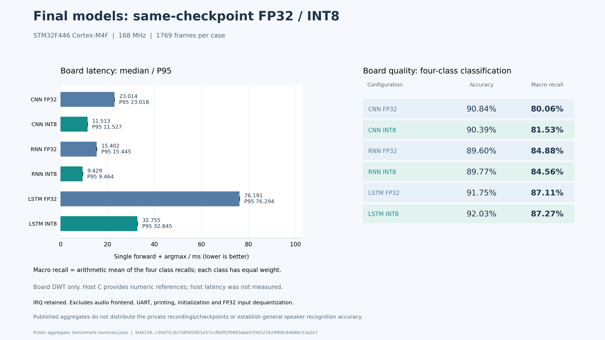
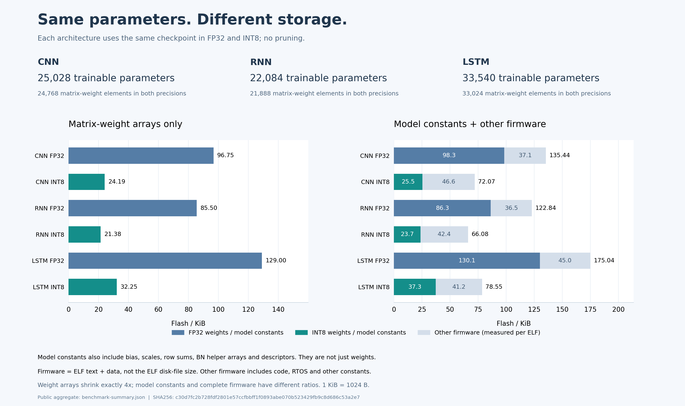

# STM32F446 同模型 FP32/INT8 实测报告

测量日期：2026-10-28。范围：最终CNN、RNN、LSTM各一份固定checkpoint，两精度共六份固件。
本报告为既有真实板测的公开聚合版本；本次源码整理没有重新训练模型或重新测量开发板。

## 1. 目标与比较规则

评价同一模型由FP32部署为混合INT8后，速度、模型存储、完整固件和质量怎样变化。
每种架构内部固定checkpoint、输入片段、顺序、时钟、编译配置与计时边界。
不同架构的容量预算不同，横向结果只描述本次三个模型，不证明某架构普遍更好。

不把早期小CNN的计时混入本报告。下面的23.014ms属于24/32/48通道CNN，只与同checkpoint
的11.513ms配对；旧模型的内核改动A/B不是本报告的控制组。

## 2. 方法

### 设备与计时

| 条件 | 实际设置 |
|---|---|
| 处理器 | STM32F446，Cortex-M4配置含硬件单精度FPU |
| 时钟/调度 | 168MHz；自有RTOS tick1000Hz；IRQ与调度保留 |
| 编译器 | Arm GCC14.3.1，O3、硬浮点、关闭fast-math及浮点乘加融合 |
| 计时 | DWT包围一次完整forward与argmax；每case不另加预热 |
| 不计入 | 特征提取、UART、CRC、打印、初始化、FP32输入反量化 |
| 样本 | 每精度1769帧；六组共10614次实板推理 |

报告中位数和P95均来自上述无插桩完整推理，不混用主机速度、理论MAC或指令模拟时间。
没有测主机推理时延；参考CSV中的cycles=0不是主机耗时0ms。

### 模型与数据

| 固定模型 | 结构 | 参数个数 | 矩阵/卷积MAC | INT8权重政策 |
|---|---|---:|---:|---|
| CNN | 32×64输入；通道24/32/48；head48 | 25028 | 408768 | MSE |
| RNN | T16/I128/H96 | 22084 | 344448 | MSE |
| LSTM | T32/I64/H64 | 33540 | 1048832 | MaxAbs |

输入为相同32 Mel×64时间的uint8特征，scale=1/255，每帧对应0.512秒声音；CNN与循环网络按
各自布局打包。测试为无人声、其他人、目标A、目标B四类，支持数788/800/139/42，共25个WAV；
两个具名目标各仅1个测试WAV，片段相关。本报告使用通用类别标签，不提供原始语音或实际
说话人checkpoint；校准工具保留历史类名的兼容映射，不宣称整个源码库具有不可关联匿名性。

训练共38次尝试，最终政策按validation固定，未根据本轮新test成绩改选。此test是历史已经
观察过的冻结回归集，不能称为新的盲测或大规模说话人验证集。最终CNN是validation规则预定
的实验默认，不因本次LSTM test分数更高而事后替换。

## 3. 速度与识别质量

| 同一固定模型 | FP32中位/P95 ms | INT8中位/P95 ms | 中位加速 |
|---|---:|---:|---:|
| CNN | 23.014357 / 23.017661 | 11.513256 / 11.527185 | 1.999倍 |
| RNN | 15.402208 / 15.445446 | 9.428994 / 9.463940 | 1.633倍 |
| LSTM | 76.190982 / 76.294173 | 32.754565 / 32.845202 | 2.326倍 |

| 同一固定模型 | FP32准确率 | INT8准确率 | FP32宏召回 | INT8宏召回 |
|---|---:|---:|---:|---:|
| CNN | 90.8423% | 90.3901% | 80.0579% | 81.5255% |
| RNN | 89.5986% | 89.7682% | 84.8826% | 84.5643% |
| LSTM | 91.7467% | 92.0294% | 87.1141% | 87.2718% |

INT8的矩阵运算与FP32使用不同内核，并保留尺度、状态、非线性等浮点步骤。因此表中是精度
部署加速，不能全部归因于DSP指令，也不能由权重的4倍压缩推出时间必然快4倍。

### 宏召回的定义与意义

若第c类有$N_c$个真实样本、正确识别$TP_c$个，$N=\sum_cN_c$，则：

$$
R_c=\frac{TP_c}{N_c},\qquad
MacroRecall=\frac1C\sum_cR_c,\qquad
Accuracy=\sum_c\frac{N_c}{N}R_c.
$$

准确率让每个样本等权，宏召回让每个类别等权。本集四类都有支持；聚合数据的宏召回等于
balanced accuracy，不等于宏F1或精确率。

CNN INT8各类正确数为708/748/119/24，召回89.8477%/93.5%/85.6115%/57.1429%。因此总体
准确率1599/1769=90.3901%，宏召回只有81.5255%。前两类占约89.77%的样本，说明总体准确率
可能掩盖目标B的较差召回；每类等权也不能消除目标B只来自一个WAV的不确定性。

## 4. 参数、Flash与RAM

### 参数个数与权重字节

| 固定模型 | 可训练参数个数，FP32→INT8 | 矩阵权重个数，FP32→INT8 | 矩阵权重字节，FP32→INT8 |
|---|---:|---:|---:|
| CNN | 25028→25028 | 24768→24768 | 99072→24768 B |
| RNN | 22084→22084 | 21888→21888 | 87552→21888 B |
| LSTM | 33540→33540 | 33024→33024 | 132096→33024 B |

量化只改变数值表示，矩阵元素个数不变；每个FP32权重4B变为INT8的1B，准确减少75%。
训练参数还含bias和BN仿射参数，部署有BN融合/偏置合并，不能把训练参数个数乘4当作全部
ELF常量。MAC也不包含所有量化和非线性操作。

### 完整固件的独立分解

| 固定模型 | 精度 | 模型常量 B | 其余固件 B | text+data B |
|---|---|---:|---:|---:|
| CNN | FP32 | 100648 | 38040 | 138688 |
| CNN | INT8 | 26100 | 47704 | 73804 |
| RNN | FP32 | 88376 | 37408 | 125784 |
| RNN | INT8 | 24284 | 43384 | 67668 |
| LSTM | FP32 | 133172 | 46064 | 179236 |
| LSTM | INT8 | 38232 | 42200 | 80432 |

模型常量包含权重、FP32 bias/scale、预计算行和、描述符及实际链接的BN辅助数组，按实际ELF
符号地址并集统计。其余固件含算子、RTOS/HAL/UART/C库及其他常量，两精度分别统计，不假定
相同。所有INT8固件均未重复保留整套FP32权重。

模型常量缩小3.856/3.639/3.483倍，完整固件缩小1.879/1.859/2.228倍。后者不等于权重压缩比。
`text+data`是Flash载荷口径，ELF磁盘文件还可包含调试信息，不能混用。

| 固定模型 | FP32静态RAM B | INT8静态RAM B | FP32→INT8 workspace B |
|---|---:|---:|---:|
| CNN | 59648 | 48480 | 9280→6304 |
| RNN | 56512 | 46272 | 6144→4096 |
| LSTM | 58816 | 48064 | 8448→5888 |

静态RAM为SRAM内data+bss，已含workspace、32768B RTOS heap arena及其中任务栈。
FP32另含8192B输入暂存，INT8没有；表外每份固件还有1540B链接器预留。RAM减少不是简单地把
全部激活改为INT8，不能重复累加workspace与任务栈。

## 5. 正确性与准入

六组全部1769帧的板端logit与各自主机C参考逐位相同；这不表示FP32和INT8彼此无量化误差。
相对FP32，三种INT8正确数改变-8/+3/+5。另完成45步串口恢复/异常资格，含12次预期拒绝和
33次有效结果；最终默认CNN还进行整片Flash回读、复位及8帧启动检查。

CNN/RNN最初对PyTorch的原组合容差分别有40/7076和2/7076个logit值超限；没有抹去该失败。
它们采用显式允许的另一条准入：所有帧与独立有序binary32参考逐位相同、与PyTorch分类全相同。
CNN涉及BN折叠和归约顺序；RNN还采用确定性非线性契约。LSTM直接通过原PyTorch组合容差。
原门槛为$|e|\le2\times10^{-5}+2\times10^{-5}|y_{ref}|$；板与对应主机C及整数参考的门槛未放宽。

## 6. 局限与结论

- RNN test准确率仍为89.77%，没有达到三模型均超过90%的目标。
- CNN总体准确率超过90%，宏召回只有81.53%；三个新学生对目标B的召回均较旧版本下降。
- 测试仅两个目标、各一个WAV，不能据此宣布一般说话人识别/验证能力或公平比较全部架构。
- 未测电流、能耗、冷启动、长期温度稳定性或M7/Cortex-A的实际设备速度。
- 源码整理/CI可以复现合成模型的转换与编译闭环，不能在缺少私有数据和原硬件工程时重跑
  上述历史识别率。公开报告不是完整原始审计的替代品。

本次测量支持的结论是：在这些固定模型和指定F446条件下，混合INT8减少权重与固件占用，并
获得约1.63～2.33倍精度部署加速；识别质量存在需要逐类检查的取舍。

## 7. 数据来源与复现层级

[公开聚合JSON](assets/benchmark-summary.json)保留通用类别标签、同模型身份、六组资源/时间/混淆
矩阵及原始审计摘要。原始语音、说话人权重、设备标识、绝对磁盘路径与串口字节未分发。
公开图从该JSON生成，图的脚注和PNG元数据绑定该快照，而不是某台机器的文件路径。

开发验证与方法说明见[使用手册](guide.md#validation)。安装开发依赖后，可在新的输出目录
重画报告图；具体参数见`python ai_baseon_c/tools/plot_benchmark_report.py --help`。
运行库/转换器测试使用合成数据，与本报告的语音质量测量分开报告。

仓库文本统一换行为LF；原本地测量清单的文件SHA属于当时源码字节，不能为匹配公开克隆的
换行规范而改写历史摘要。原始证据保留在研究工作区，公开聚合快照只提供可复算的结果层。

## 8. 源码发布与跨平台验证

源码仓库为[ArchHang/AI4C_Tool](https://github.com/ArchHang/AI4C_Tool)。发布范围包括C推理库、
转换器、GUI、合成回归模型、测试和公开文档；真实录音、训练权重、第三方SDK及本机环境快照
保留在原研究工作区。目录归属和清理规则见[工程目录管理](project_layout.md)。

[持续集成](https://github.com/ArchHang/AI4C_Tool/actions/workflows/portable-check.yml)覆盖Linux和
Windows，分别使用Python 3.10/CMake及Python 3.12/Make。每个组合检查原生C测试、
CNN/RNN/LSTM合成模型的转换与C程序运行、Python回归和实际Tk显示环境下的GUI控制器。
检查不依赖原电脑上的私有数据；失败和跳过均保留为未通过，诊断JSON保存7天。
具体环境版本、测试数量及结果以对应提交的Actions记录为准，不能用一次本地通过代替整个矩阵。

发布测试发现了两个此前本机环境没有暴露的问题。其一，较新版NumPy移除了私有NPY文件头
解析接口。现在使用公开接口读取1.0/2.0格式，并按[NumPy官方格式说明](https://numpy.org/doc/stable/reference/generated/numpy.lib.format.html)
受限解析3.0的UTF-8元数据；
解析前先检查文件头长度，继续禁止对象数组和pickle，并核对形状、容量及实际负载大小。
其二，两个完全相同的剪枝通道具有相同理论损失，但不同线性代数实现的FP64舍入可让代价
相差一个ULP，从而改变被删通道。选择器在明确的相对舍入窗口内按原通道编号稳定选择，
记录实际选择代价与并列信息；原有重建质量断言保持不变。

另一个统计回归用例混用了在`inference_mode`内、外构建模型的方式，令参数的推理张量属性
不同；在输入和权重相同时，也观察到了FP32末位差异。参考模型现在与实际评估使用相同的
构建方式，并对同次执行的logit独立复算统计指标，补充确定输出、多批次的精确验证。
原有指标比较的小数位要求、分类检查和C数值门槛没有因此放宽。

这些修复提高的是转换软件的兼容性和剪枝过程的可重复性，没有改变前文六组固件的测量值，
也不构成新的硬件性能测试。C推理内核没有因源码发布而重新实现。
